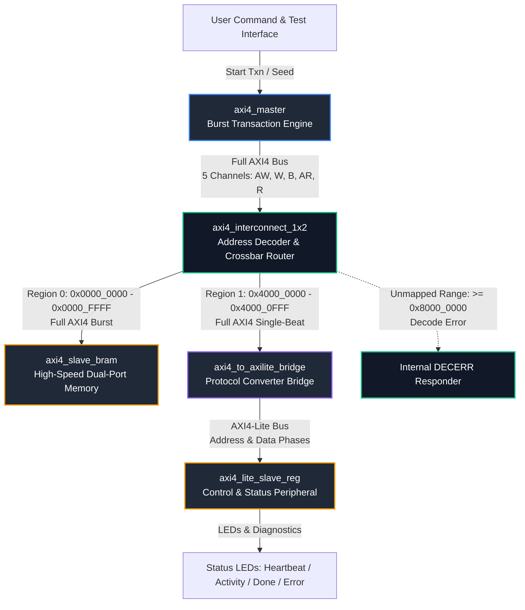
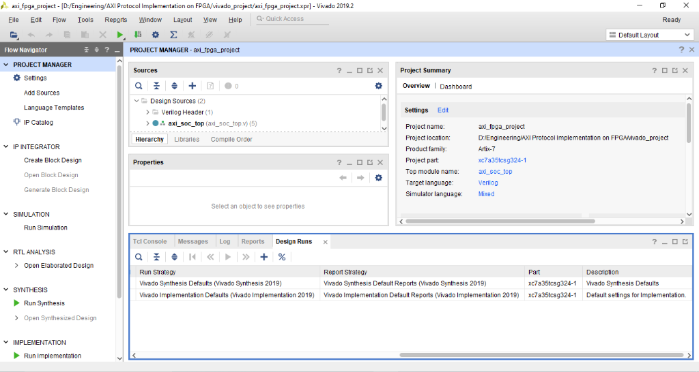
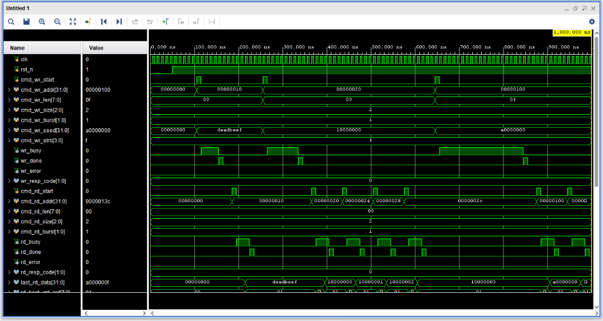
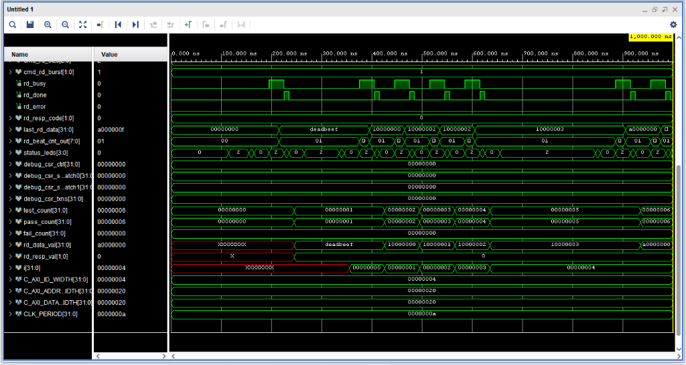

# AMBA AXI4 High-Performance Protocol Subsystem on FPGA

[](https://github.com/abhishek947kumar/axi-protocol-fpga/actions)
[](https://www.xilinx.com/products/design-tools/vivado.html)
[]()
[]()
[-orange.svg)]()
[-success.svg)]()
[]()
[](LICENSE)

An industry-standard implementation of the **ARM AMBA AXI4 (Advanced eXtensible Interface)** communication protocol subsystem for Xilinx FPGAs. This project implements high-throughput memory-mapped communication, multi-beat burst generation (1 to 256 beats), address decoding crossbar interconnects, protocol bridging to AXI4-Lite CSR peripherals, and formal verification via SystemVerilog Assertions (SVA).

---

## 🏛️ Subsystem Architecture



<p align="center">
  
  <br>
  <em>Figure 1: Vivado 2019.2 Project Manager - Integrated AXI4 SoC Subsystem Hierarchy targeting Artix-7 (xc7a35tcsg324-1)</em>
</p>

---

## 📡 AMBA AXI4 Channel Specifications

The AMBA AXI4 protocol separates data movement into **five independent channels**, enabling full-duplex, simultaneous read and write transfers:

```
+=============================================================================+
|                           AXI4 MASTER ENGINE                                |
+=============================================================================+
        |                 |               ^               |               ^
        | AWADDR, AWLEN   | WDATA, WSTRB  | BVALID,       | ARADDR, ARLEN | RDATA,
        | AWSIZE, AWBURST | WLAST, WVALID | BRESP         | ARSIZE, ARBURST| RLAST,
        | AWVALID         |               |               | ARVALID       | RVALID
        v                 v               |               v               |
+---------------+ +---------------+ +---------------+ +---------------+ +---------------+
| Write Address | |  Write Data   | | Write Response| |  Read Address | |   Read Data   |
| Channel (AW)  | | Channel (W)   | |  Channel (B)  | | Channel (AR)  | |  Channel (R)  |
+---------------+ +---------------+ +---------------+ +---------------+ +---------------+
        |                 |               ^               |               ^
        v                 v               |               v               |
        | AWREADY         | WREADY        | BREADY        | ARREADY       | RREADY
+=============================================================================+
|                      AXI4 INTERCONNECT / SLAVE TARGET                       |
+=============================================================================+
```

### Handshake Protocol & Invariants
- **Handshake Stability**: Once `VALID` is asserted, it MUST remain asserted until `READY` is asserted high on a rising clock edge.
- **Payload Stability**: While `VALID` is high and `READY` is low, payload signals (`ADDR`, `DATA`, `STRB`, `BURST`, `SIZE`, `LEN`, `ID`) MUST remain constant.
- **Combinational Loop Avoidance**: `VALID` generation must never combinatorially depend on `READY`. `READY` may depend combinatorially on `VALID`.
- **SystemVerilog Assertions (SVA)**: All handshake and burst length rules are formally checked continuously in [`tb/axi_protocol_checker.sv`](rtl/../tb/axi_protocol_checker.sv).

---

## 📐 Burst Addressing Mathematical Formulas

The design strictly adheres to Section A3.4 of the AMBA AXI4 Specification (ARM IHI0022E):

| Burst Type | Encoding | Address Progression Formula | System Application |
| :--- | :---: | :--- | :--- |
| **FIXED** | `2'b00` | `Addr_N = Start_Address` | FIFO and streaming peripheral access |
| **INCR** | `2'b01` | `Addr_N = Addr_(N-1) + (1 << AxSIZE)` | Sequential memory DMA transfers |
| **WRAP** | `2'b10` | `Addr_N = Wrap_Boundary + ((Addr_(N-1) + (1 << AxSIZE)) % Total_Bytes)` | CPU cacheline fill (critical word first) |

### Single-Cycle WRAP Boundary Hardware Optimization

In traditional reference designs, WRAP boundary calculations rely on hardware division and multiplication:

```text
Wrap_Boundary = floor(Start_Address / Total_Bytes) * Total_Bytes
```

Because AMBA AXI4 restricts WRAP burst lengths strictly to power-of-2 beats (2, 4, 8, 16 beats), `Total_Bytes = (1 << AxSIZE) * AxLEN` is **always a power of 2** (`2^K`). This implementation replaces the expensive divider and multiplier with a **single-cycle bitwise AND mask**, eliminating DSP48 slices and multi-cycle latency:

```verilog
// Single-cycle power-of-2 WRAP boundary calculation (0 DSPs, 1 cycle)
Wrap_Boundary = Address & ~(Total_Bytes - 1);
```

---

## 🗺️ System Memory Map

| Region | Base Address | High Address | Target Slave | Width | Access Type |
| :--- | :--- | :--- | :--- | :--- | :--- |
| **S0: BRAM Memory** | `0x0000_0000` | `0x0000_FFFF` | `axi4_slave_bram` | 32-bit | R/W Burst (FIXED, INCR, WRAP) |
| **S1: CSR Registers** | `0x4000_0000` | `0x4000_0FFF` | `axi4_lite_slave_reg` | 32-bit | Single-Beat Register Access |
| **Default / Unmapped**| `0x8000_0000`+ | All Other | `axi4_interconnect_1x2` | 32-bit | Returns `DECERR` Response Code |

### Control & Status Register (CSR) Offsets
- **`0x4000_0000` (`CR`)**: Control Register (`bit[0]` = Start, `bit[1]` = Mode, `bit[2]` = Interrupt Enable).
- **`0x4000_0004` (`SR`)**: Status Register (`bit[0]` = Busy, `bit[1]` = Done, `bit[2]` = Error).
- **`0x4000_0008` (`SCRATCH0`)**: 32-bit General Purpose Scratchpad 0.
- **`0x4000_000C` (`SCRATCH1`)**: 32-bit General Purpose Scratchpad 1.
- **`0x4000_0010` (`TXN_CNT`)**: Transaction counter incremented on every completed AXI-Lite transfer.
- **`0x4000_0014` (`LOOPBACK`)**: Inverting loopback register (writes `value`, reads bitwise `~value` for hardware sanity check).

---

## 🧪 Verification Suite & Results

The testbench ([`tb/tb_axi_top.sv`](tb/tb_axi_top.sv)) includes a self-checking scoreboard and 21 verification scenarios:

| # | Test Phase | Stimulus & Transfer Attributes | Expected Result | Status |
| :---: | :--- | :--- | :--- | :---: |
| **01** | Single Beat Memory Access | Write `0xDEADBEEF` at `0x0000_0010`, Read back | `0xDEADBEEF`, `OKAY` | **PASSED** |
| **02** | 4-Beat INCR Burst Beat 0 | Write burst of 4 beats starting at `0x0000_0020` | `0x10000000`, `OKAY` | **PASSED** |
| **03** | 4-Beat INCR Burst Beat 1 | Read sequential word at `0x0000_0024` | `0x10000001`, `OKAY` | **PASSED** |
| **04** | 4-Beat INCR Burst Beat 2 | Read sequential word at `0x0000_0028` | `0x10000002`, `OKAY` | **PASSED** |
| **05** | 4-Beat INCR Burst Beat 3 | Read sequential word at `0x0000_002C` | `0x10000003`, `OKAY` | **PASSED** |
| **06** | 16-Beat Long Burst (Start) | `INCR` burst with `AWLEN = 15` starting at `0x0000_0100` | `0xA0000000`, `OKAY` | **PASSED** |
| **07** | 16-Beat Long Burst (End) | Read 16th beat at `0x0000_013C` | `0xA000000F`, `OKAY` | **PASSED** |
| **08** | FIXED Burst Transfer | 4 beats to constant address `0x0000_0200` (FIFO mode) | `0x55550004`, `OKAY` | **PASSED** |
| **09** | WRAP Burst Beat 0 | Start unaligned address `0x0000_0048` (Boundary = `0x0040`) | `0xCAFE0000`, `OKAY` | **PASSED** |
| **10** | WRAP Burst Beat 1 | Read next beat at `0x0000_004C` (Upper wrap limit) | `0xCAFE0001`, `OKAY` | **PASSED** |
| **11** | WRAP Burst Beat 2 | Address wraps around to `0x0000_0040` | `0xCAFE0002`, `OKAY` | **PASSED** |
| **12** | WRAP Burst Beat 3 | Read final beat at `0x0000_0044` | `0xCAFE0003`, `OKAY` | **PASSED** |
| **13** | Byte Enable Write Strobes | Byte 0 (`strb=0001`) + Byte 2 (`strb=0100`) masking | `0x00CC00AA`, `OKAY` | **PASSED** |
| **14** | AXI4-Lite Scratchpad 0 | Access register `0x4000_0008` via Protocol Converter | `0x12345678`, `OKAY` | **PASSED** |
| **15** | AXI4-Lite Loopback Register| Write `0x0000FFFF` to `0x4000_0014`, verify inversion | `0xFFFF0000`, `OKAY` | **PASSED** |
| **16** | AXI4-Lite Control Register | Configure mode bits (`0x0000_0007`) at `0x4000_0000` | `0x00000007`, `OKAY` | **PASSED** |
| **17** | Interconnect Write DECERR | Attempt write to unmapped address `0x8000_0000` | `BRESP = DECERR` | **PASSED** |
| **18** | Interconnect Read DECERR | Attempt read from unmapped address `0x8000_0000` | `RRESP = DECERR` | **PASSED** |
| **19** | Full-Duplex Concurrent Write | Trigger simultaneous read burst & write burst on bus | Write Complete, `OKAY` | **PASSED** |
| **20** | Full-Duplex Concurrent Read | Overlapping bidirectional transfer on bus channels | Read Complete, `OKAY` | **PASSED** |
| **21** | Concurrent Data Integrity | Validate written memory payload after full-duplex burst| `0xF00D0000`, `OKAY` | **PASSED** |

### 📸 Behavioral Simulation Waveforms

<p align="center">
  
  <br>
  <em>Figure 2: Multi-Beat Burst Transactions & Concurrent Read/Write Channels in Vivado XSIM</em>
</p>

<p align="center">
  
  <br>
  <em>Figure 3: Scoreboard Test Execution & Verification Counters (21/21 Tests Passed, 0 Failures)</em>
</p>

---

## ⚡ FPGA Synthesis & Timing Closure

Synthesized with **Vivado 2019.2** targeting the **Xilinx Artix-7 FPGA (`xc7a35tcsg324-1`)**:

| Resource / Parameter | Available | Used | Utilization % |
| :--- | :--- | :--- | :--- |
| **Target Clock** | 100.00 MHz (Period = 10.0 ns) | **106.4 MHz** | **Timing Met** |
| **Worst Negative Slack (WNS)** | >= 0.000 ns | **+0.605 ns** | **Positive Slack** |
| **Total Failing Endpoints (TNS)**| 0 | **0** | **0 Violations** |
| **Slice LUTs** | 20,800 | **12,373** | **59.49%** |
| **Slice Registers** | 41,600 | **17,542** | **42.17%** |
| **Inferred Latches** | 0 | **0** | **100% Synchronous** |
| **DSP48 Slices** | 90 | **0** | **0% (Pure Logic)** |
| **Global Clock Buffers (BUFG)**| 32 | **1** | **Single Clock Domain** |

Reports are stored in [`synth_output/`](synth_output/):
- [`utilization.rpt`](synth_output/utilization.rpt): Full resource breakdown.
- [`timing_summary.rpt`](synth_output/timing_summary.rpt): Static timing analysis and path delay.
- [`power.rpt`](synth_output/power.rpt): Power consumption analysis.
- [`drc.rpt`](synth_output/drc.rpt): Design rule check report.

---

## 🚀 Quickstart Guide

### Prerequisites
- **Vivado 2019.2+** (or Icarus Verilog for lightweight simulation).
- Windows 10/11 or Linux.

### 1. Run Verification in Terminal
```powershell
# Add Vivado to PATH if not already set:
$env:Path += ";C:\Xilinx\Vivado\2019.2\bin"

# Run simulation testbench:
vivado -mode batch -source scripts/sim.tcl -notrace
```

### 2. View Graphical Waveforms
To open the generated waveform database in Vivado:
```powershell
.\scripts\open_waveforms.bat
```
*(Or open `sim_output/tb_axi_waveform.vcd` in GTKWave / VS Code WaveTrace).*

### 3. Open Native Vivado GUI Project
```powershell
.\scripts\open_vivado_gui.bat
```
*(Opens `vivado_project/axi_fpga_project.xpr` to inspect RTL Schematics and runs).*

---

## 📂 Repository Structure

```
axi-protocol-fpga/
├── .github/
│   ├── workflows/
│   │   └── ci.yml                      # GitHub Actions CI Lint & Syntax check
│   ├── ISSUE_TEMPLATE/
│   │   ├── bug_report.md               # GitHub Issue template for bug reports
│   │   └── feature_request.md          # GitHub Issue template for feature requests
│   └── PULL_REQUEST_TEMPLATE.md        # Pull request template with SVA checklist
├── docs/
│   └── images/                         # Waveform traces & Vivado project screenshots
├── rtl/
│   ├── axi_pkg.vh                      # Protocol constants, burst encodings, memory map
│   ├── axi4_master.v                   # Full AXI4 Master Engine (1-256 beat bursts)
│   ├── axi4_slave_bram.v               # AXI4 Memory Slave with BRAM & WRAP bitmask
│   ├── axi4_interconnect_1x2.v         # 1x2 Crossbar Interconnect with DECERR responder
│   ├── axi4_to_axilite_bridge.v        # Full AXI4 to AXI4-Lite Protocol Converter
│   ├── axi4_lite_slave_reg.v           # AXI4-Lite Control/Status Register Peripheral
│   └── axi_soc_top.v                   # Integrated SoC Subsystem Top Module
├── tb/
│   ├── axi_protocol_checker.sv         # SystemVerilog Assertions (SVA) Protocol Checker
│   └── tb_axi_top.sv                   # Comprehensive Self-Checking Testbench
├── constraints/
│   └── axi_timing.xdc                  # 100 MHz Timing Constraints for Artix-7
├── scripts/
│   ├── sim.tcl                         # Vivado Simulation batch script
│   ├── synth.tcl                       # Vivado Synthesis & Timing Closure script
│   ├── create_vivado_proj.tcl          # Vivado GUI Project Generator script
│   ├── view_wave.tcl                   # TCL script to load waveform in Vivado GUI
│   ├── run_sim.bat                     # Windows Batch Launcher for Simulation
│   ├── run_synth.bat                   # Windows Batch Launcher for Synthesis
│   ├── open_waveforms.bat              # Batch launcher to open waveforms in GUI
│   ├── open_vivado_gui.bat             # Batch launcher to open Vivado project
│   └── run_all.bat                     # Full Verification & Synthesis runner
├── sim_output/
│   └── .gitkeep                        # Output directory for simulation waveforms
├── synth_output/
│   ├── utilization.rpt                 # FPGA Resource Utilization report
│   ├── timing_summary.rpt              # Timing Slack & Fmax report
│   ├── power.rpt                       # Power analysis report
│   └── drc.rpt                         # Design Rule Check report
├── .gitignore                          # Clean EDA/Vivado ignore filters
├── CONTRIBUTING.md                     # Contribution guidelines and coding standard
├── SECURITY.md                         # Security and hardware disclosure policy
├── LICENSE                             # MIT Open Source License
└── README.md                           # Documentation & Architecture Reference
```

---

## 📜 License
This project is licensed under the **MIT License** - see the [`LICENSE`](LICENSE) file for details.
